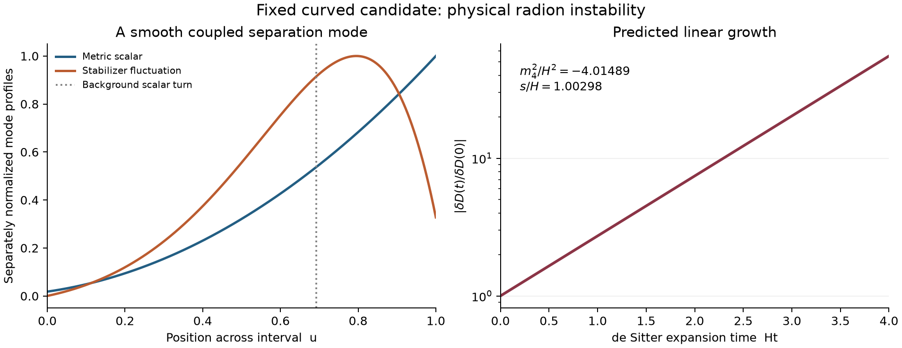

# The fixed curved background has a physical radion instability

**The authorized stability test is complete: the qualified positive-curvature candidate is linearly unstable in its coupled stabilizer–geometry sector.** A smooth, positive-kinetic mode changes the proper distance between the branes and grows on the de Sitter expansion timescale. Finite wall stiffness is included. This candidate does not pass the prerequisite for a donor-source experiment on a stable reference background.

The calculation held all six bulk/wall parameters and the authenticated background fixed. It did not retune a parameter, evolve donor matter, restart collapse, or modify any predecessor or publication result.

## Decisive physical result

The four-dimensional mode satisfies Box_gamma q=m4^2 q. In the normalization a_lower=1, with k=H^2=0.0003268413384542497, the accepted regular shooting mode gives:

| Quantity | Result |
|---|---:|
| Physical mass squared m4^2 | -0.0013122306828 |
| m4^2/H^2 | -4.014885905 |
| Shifted spectral value m4^2+4H^2 | -4.86532898 × 10^-6 |
| Growing exponent s/H | 1.002975410 |
| E-fold time in units H^-1 | 0.9970334165 |
| E-fold time in lower-wall proper-time units, ell=1 | 55.14945490 |
| Doubled-cover kinetic coefficient Z, with psi_lower=1 | +321.2840530 |
| Proper-separation overlap delta D/(q sqrt(Z)) | -2.987261545 |

These displayed values identify a numerical result, not rigorous continuum intervals. Mode normalization is arbitrary; a physical linear perturbation multiplies the eigenfunction by an infinitesimal amplitude. The nonzero normalized separation overlap establishes the radion character. Positive Z shows that this is a tachyonic instability with ordinary kinetic sign, rather than a ghost or a negative norm from a singular matrix representation.

On the expanding de Sitter chart, each spatial Fourier mode obeys

\[
 \ddot q+3H\dot q+[p_{\rm com}^2e^{-2Ht}+m_4^2]q=0.
\]

Its late growing branch has q proportional to exp(st), with s/H=sqrt(9/4-m4^2/H^2)-3/2. This is physical separation growth, not an assumption of a flat, globally static time coordinate. Proper time and the local Hubble rate on the other brane both rescale by its warp factor. No conversion to seconds or cosmological years has been selected. Nonlinear evolution and the endpoint of the instability were not calculated.

Left: the two smooth mode profiles are normalized separately to display their shapes. The dotted line marks the background scalar turning point. Right: the growing-branch prediction from the measured mass, with arbitrary infinitesimal initial normalization; this is not a new time-domain simulation.

## Why the mode is physical

The original scalar derivative crosses zero at u=0.6925030526. A divided master variable would be singular there. The calculation instead keeps the metric scalar psi, scalar fluctuation f and f' in a regular system, with the independent Einstein constraint propagated as C'=-2AC. The mode crosses the turn smoothly and satisfies its algebraic matching relation.

Both finite scalar-wall conditions use gamma=20 and the one-sided orbifold factor gamma/2. The perturbed Israel condition is also retained through the mixed Einstein constraint and background junctions. Fixing coordinate wall positions does not freeze the radion: the perturbation of proper separation is delta D/q=-2 integral a psi dz. The full bent-wall derivation identifies the exceptional de Sitter embedding harmonics; this mode is separated from their mass m4^2=-4k by a resolved 4.8653 × 10^-6.

The kinetic coefficient follows from the actual doubled-cover action,

\[
 Z=2\int a^3(f^2+6\psi^2)\,dz>0.
\]

It contains no division by the scalar gradient and receives no intrinsic kinetic contribution from the pure-potential walls. See the [independent derivation](analysis/INDEPENDENT_FORMULATION.md), [kinetic/control review](analysis/KINETIC_AND_CONTROL_REVIEW.md), and [final physical review](analysis/PHYSICAL_RESULT_REVIEW.md).

## Evidence that settles the sign

The formulation, comparisons and criteria were [frozen before the science evaluation](TEST_SPECIFICATION.md). The flat massless-radion limit, the exact de Sitter vacuum radion m4^2=-4k, and an independent finite-Robin scalar control passed. Exact symbolic differentiation verifies constraint propagation.

Four coupled spectral resolutions and three regular shooting tolerances find the same negative branch. The largest measured mass discrepancy among the declared comparisons is **1.01 × 10^-11**, approximately 130 million times smaller than the magnitude of the negative mass squared. This is an observed numerical sensitivity, not a rigorous error bound.

| Independent comparison | Absolute mass-squared change |
|---|---:|
| Finest spectral mass versus tight shooting | 1.01 × 10^-11 |
| Last two spectral resolutions | 8.19 × 10^-12 |
| Finest two shooting tolerances | 3.69 × 10^-18 |
| Preceding versus qualified background representation | 5.26 × 10^-15 |
| 60-digit fixed-step integration versus tight shooting | 7.50 × 10^-17 |
| Last RK4 step refinement | 1.13 × 10^-15 |

The 40- and 60-digit integrations agree at the same step count to approximately 40 displayed digits. They evolve the retained binary64 background polynomial; they do not turn its inherited numerical background into a high-precision existence proof. The spectral and adaptive solvers themselves use binary64.

A separately implemented verifier differentiates the saved fields rather than substituting the evolution right-hand sides. It checks the bulk momentum equation, remaining Einstein constraint, scalar equation and both walls, including one-sided endpoint derivatives. Its largest normalized equation residual is **3.30 × 10^-10**, below the frozen 10^-6 criterion. The kinetic norm and separation overlap agree independently. [Residual evidence](analysis/INDEPENDENT_MODE_CHECK.md)

One numerical limitation is preserved: the N65 and N97 spectral **profiles** fail the scalar-equation residual criterion, with maxima 6.00 × 10^-6 and 7.22 × 10^-5. Their masses are useful frequency comparisons, but those profiles are not accepted physical representations. The result rests on the independently differentiated regular shooting profile, supported by the lower-resolution spectral profiles. No tolerance was relaxed; the [execution notes](analysis/EXECUTION_NOTES.md) record this distinction.

## Consequence for the research line

This candidate exists numerically as a warped de Sitter solution but is not a linearly stable reference state. The four-dimensional curvature contributes the familiar -4H^2 shift; the measured shifted eigenvalue is also negative, so the fixed scalar/wall configuration does not offset the instability. This is a diagnosis of the declared candidate, not a parameter scan or a comparison with an unavailable flat background.

**Stop this candidate's stability test here. Do not proceed to donor accretion on the assumption that it is stabilized.** No retuning or search for an alternative branch was launched. A different stable background, or a deliberately dynamical research question, would require a separately specified investigation.

One resolved physical growing mode is sufficient for this decision. No claim is made to a globally lowest eigenvalue, complete spectral enumeration, nonlinear fate, an event horizon, a halo mechanism, or G10's endpoint. The separate finite-resolution MOTS/dynamical-horizon results are unchanged.

The general possibility of a de Sitter radion instability is established literature, not a new mechanism claimed here: [Frolov and Kofman, Physical Review D 69, 044021 (2004)](https://arxiv.org/abs/hep-th/0309002). The present contribution is the finite-stiffness, regular-turning-point determination for this authenticated fixed candidate.

## Reproducibility and preservation

The [machine-readable decision](results/SUMMARY.json), [run specification](TEST_SPECIFICATION.md), [replay instructions](REPRODUCE.md), source, eigenvalues, mode arrays, individual receipts and [integrity manifest](MANIFEST.json) are retained here. The three inherited candidate anchors and 14 additional inherited source bindings were authenticated. The earlier fine representation was separately authenticated against its recorded receipt and payload hashes. Final preservation checks confirm the predecessor bindings remain unchanged.

All calculations used the existing Linux runtime and shared successor storage. Each numerical case took seconds, so no hour-long process or checkpointed long job was needed. No archive cleanup, package installation, unrelated process change, or external publication action occurred.
