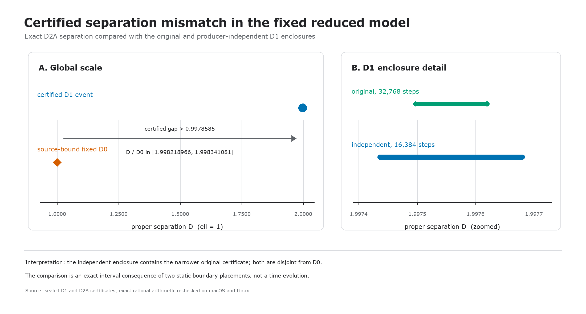
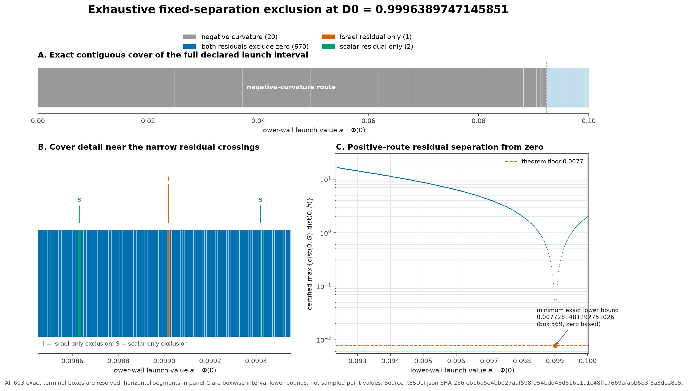

# Lin theorem and causal-readiness research window

## Outcome

The static branch is ready for a narrow theorem manuscript draft. It is not yet
submission-ready.

For one fixed five-dimensional Einstein--scalar two-wall model, the reconciled
certificates establish:

1. a locally unique positive-curvature first-event shooting root, with proper
   separation near `1.9975`; and
2. exhaustive exclusion of any positive-curvature simultaneous wall root at
   exact source-bound separation `D0=0.9996389747145851` over the complete
   declared `0<=a<=v0` launch interval.

Using the narrower original D1 enclosure, exact arithmetic gives

```text
D - D0 in [0.9978585838791649, 0.9979806541916649]
D / D0 in [1.9982189661663317, 1.9983410805652175]
```

The source-pinned separation mismatch is therefore a certified property of the
declared reduced static family, not an ordinary root-finder miss.



The fixed-separation theorem is summarized independently by its exact cover
and interval residual floor:



## Recommended reading order

1. `FINAL_REPORT.md` — outcome, issues, ranked next work, and claim boundary;
2. `RESULT.json` — machine-readable classification and decisive values;
3. `MANUSCRIPT_READINESS.md` — decision and central result;
4. `THEOREM_AND_PROOF_DRAFT.md` — manuscript-form statement and proof;
5. `FORMAL_REDUCTION_LEMMA.md` — action-to-shooting reduction;
6. `THEOREM_AUTHORITY_TABLE.md` — proof-bearing intervals and authorities;
7. `PROOF_OBLIGATION_AUDIT.md` — each theorem obligation and its boundary;
8. `PARAMETER_PROVENANCE_AND_MOTIVATION.md` — why this exact point matters;
9. `INSPECTION_LEDGER.md` — what was read, rederived, hash-checked, or excluded;
10. `NOVELTY_CITATION_CHAIN.md` — closest prior work and bounded novelty;
11. `METHODS_CITATION_CHAIN.md` — standard validated-numerics references and
   their exact role;
12. `INTRODUCTION_DRAFT.md` — theorem-first opening argument in journal prose;
13. `DISCUSSION_AND_CONCLUSION_DRAFT.md` — interpretation, limitations, and
    closing inference;
14. `MANUSCRIPT_BLUEPRINT.md` — theorem-first article structure;
15. `PUBLIC_ARCHIVE_INVENTORY.md` and `REPRODUCIBILITY_COMMAND_MAP.md` — clean
    package plan;
16. `FUTURE_CAUSAL_ADMISSION_CONTRACT.md` — separate prospective dynamical
    program.

Both figures are available as PNG and PDF; exact inputs, sources, renderers,
and output hashes are bound in `FIGURE_PROVENANCE.json`.

## Verification

From this directory:

```bash
PYTHONDONTWRITEBYTECODE=1 PYTHONHASHSEED=0 PYTHONNOUSERSITE=1 \
python3 -B verify_window.py
```

Before the terminal seal this reports `local_manifest=NOT_YET_SEALED`; after
sealing it must report `local_manifest=PASS` and
`LIN_THEOREM_READINESS_WINDOW=PASS`. The dependency-free theorem checks pass on
both macOS and Linux. They verify existing sealed certificates; they do not
rerun the expensive interval integrations.

## Claim boundary

The theorem does not establish parameter robustness, global uniqueness,
stability, radion motion, dynamical selection, collapse, trapped surfaces, an
event horizon, or a baby universe. The static result does not depend on the
unresolved causal program, and the causal program may not use the incompatible
P407/O4 late lineage.

## State integrity

This window reads sealed parents and creates a new documentation/verification
layer. It does not edit a sealed parent, consume unsealed concurrent
initial-data output, make an external deposit, or alter a manuscript,
submission, or public record.
